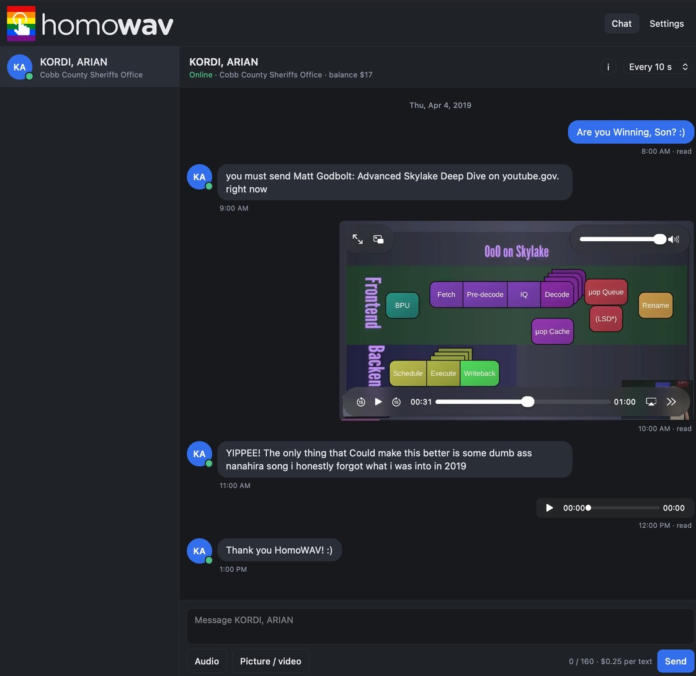
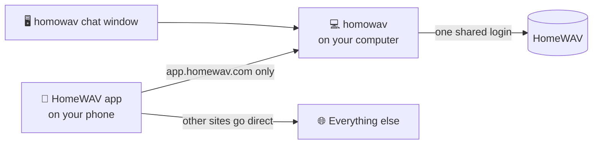

# homowav

Welcome to the README of a custom/unofficial _vibe-coded_ visitor client for HomeWAV, an app I hope you're lucky enough to never have to use.



## Get Started

Get the latest release for your OS:

<!-- https://github.com/diamondburned/dissent/blob/v0.0.41/README.md?plain=1#L71-L83 -->
<div>
    <a href="https://github.com/ariankordi/homowav/releases/latest/download/hwclient-windows-x64.exe">
        
    </a>
    <a href="https://github.com/ariankordi/homowav/releases/latest/download/hwclient-windows-arm64.exe">
        
    </a>
    <br>
    <a href="https://github.com/ariankordi/homowav/releases/latest/download/hwclient-linux-x86_64">
        
    </a>
    <a href="https://github.com/ariankordi/homowav/releases/latest/download/hwclient-linux-aarch64">
        
    </a>
    <br>
    <a href="https://github.com/ariankordi/homowav/releases/latest/download/hwclient-macos-universal.zip">
        
    </a>
</div>

## Usage

The app shows a tray icon that, when clicked, opens homowav in the browser. Here are some things to know about using the app:

### Signing In
HomeWAV only allows one session per account. In other words, if you log in on your PC, it logs you out of your phone and you lose notifications.

#### Password Sign-In (no phone)
If you don't care about the phone app or notifications, sign in with your credentials. This is the default option presented.

Saving the password (unencrypted) is optional, and it lets the app log back in by itself.

#### Phone Mode
This is a workaround that keeps you logged in on both your phone and PC. The PC runs a proxy server, and your phone sends its `app.homewav.com` traffic through it over the same network.

When you do this, _the PC captures and shares the same login as your phone_. Both stay logged in, and you still receive notifications from the phone app.

(As a bonus, the PC app automatically renews logins if the mobile app forgets, which happens pretty often...)

<!-- made by claude: -->


> [!WARNING]
> This **will not work on Android** by default. Patching the APK with [apk-mitm](https://github.com/niklashigi/apk-mitm) is supposed to fix this, but apk-mitm wasn't able to patch the app successfully. iOS works without any changes. This is because Android apps don't trust user-installed certificates by default.

To use this, open **Settings -> Phone setup** in the app, and you should see steps to set this up. In short:

1. Install and trust the app's certificate on the phone.
    - **Security:** This could be a risk if others get hold of the CA's private key in the data folder's `certs/`.
2. Set the phone's proxy to automatic, using the URL shown.
3. Keep the phone on the same network as the computer, then open the HomeWAV app on it once.

### Media (Videos, Images)
While audio (voice messages) can be freely sent, videos/images usually require facility approval.

Because of this, the app sends media as public links instead. However, **only allowed hosts are shown on the other end, and `<bucket>.s3.amazonaws.com` is the only one known to work.**

So, uploads go into your own Amazon S3 bucket.

#### Bucket Setup
Fill it in under **Settings -> Media storage**. If you have a bucket, you should already know what goes there. The only things you might not know:

* Leave **Endpoint** empty for Amazon S3.
* Files must be publicly readable, either with the `public-read` ACL or a bucket policy.
* Other S3-compatible providers (R2, MinIO, ...) will upload just fine, but the recipient may not be able to see them.

## Features

- [x] Conversation viewing w/media, old messages
- [x] Text messages
- [x] Audio messages (.m4a w/no conversion; .mp3 accepted but untested)
    - [x] Editable length
- [x] Images, GIFs, videos
    - [x] Accepts `gallery_url`
    - [x] Uploads to Amazon S3 (or S3-compatible) buckets
    - [ ] Send with facility approval
- [x] Online status, unread count, credit balance
- [x] Shares one login with the phone app (phone mode)
    - [x] Renews the login when the phone app forgets to

### Not (Yet) Supported
- [ ] **Marking messages as read**
- [ ] **Desktop notifications**
    * Via fake Android FCM registration?
- [ ] Calls
    * [ ] Video visitation (expensive...)
- [ ] Showing facility prices
    * Not working at the moment :/
- [ ] Registering new inmates
- [ ] Buying credits
- [ ] Visitation scheduling
- [ ] Anything else not listed

## Building

Node.js and Go are required to build.

1. Build the web UI

Only needed when something in `web/` changes.
```sh
cd web && npm install && npm run build
```

2. Build the Go server

```sh
go build ./cmd/hwclient
```

**On Windows:** Optionally add `-ldflags="-H=windowsgui"` to not build as a console app.

For releases, `scripts/build-release.sh <target>` builds one of five targets. It's made to build all targets from the Linux CI host.

### Development

* Run `./hwclient` for the tray/menu bar app.
    - Pass `-headless` to run only the web server.
    - Logs go to `hwclient.log` in the data folder.
* For real-time development, use `go run ./cmd/hwclient-dev` alongside `npm run dev`.
    - This runs on port 8090, and "mocks" the service so nothing goes to the real backend.

Here are some command-line flags that aren't obvious:

* `-cert`/`-key`: Uses your own certificate instead of creating one from within the app.
* `-keepalive 0`: Disables a behavior where the app renews the login every 12 hours.
    - This was originally added because it's not fully clear when logins expire.

More to be added here, hopefully.. maybe...
